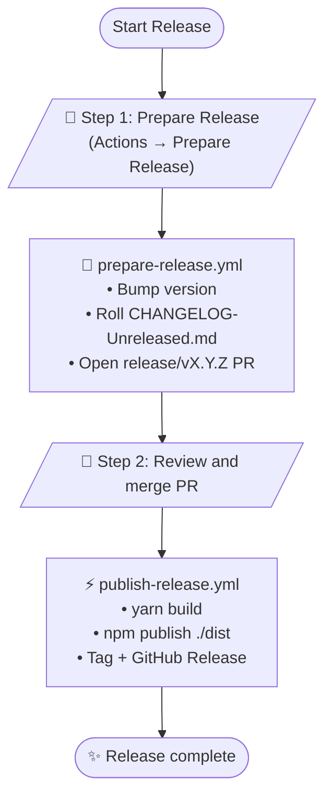

# Release Workflows

Automated releases for `nitromelondb`, modeled on the two-step process used in [react-native-google-fit](https://github.com/StasDoskalenko/react-native-google-fit).

## Workflows

### 1. `prepare-release.yml` — Prepare Release

**Trigger:** Manual (`workflow_dispatch`)

**Inputs:**

| Field | Options | Purpose |
| --- | --- | --- |
| Version bump | `none`, `promote`, `patch`, `minor`, `major` | Semver bump. `none` keeps the current X.Y.Z (next `-alpha.N`, or graduate if prerelease is `none`). `promote` ships the in-progress alpha/beta as official `X.Y.Z` and folds the changelog |
| Prerelease | `none`, `alpha`, `beta` | Optional prerelease channel. Ignored when bump is `promote` |
| npm dist-tag | `none`, `latest`, `alpha`, `beta` | `none` (default) uses the version's channel tag. Pick `latest` only when this version should be what `npm i nitromelondb` installs |
| Allow empty changelog | `true`, `false` (default `false`) | The workflow fails if `CHANGELOG-Unreleased.md` has no entries — add one, or check this only for a release that genuinely has no user-facing changes |

**What it does:**

1. Calculates the next version (see [Versioning](#versioning)). From master, it refuses `X.Y.*` versions that have a [release line](#release-lines); from a line, anything outside it
2. Skips versions that already have a git tag, GitHub Release, or npm publish (alpha/beta then increment `-alpha.N`)
3. Creates or recreates a `release/vX.Y.Z` branch from the branch it ran from (leftover branches without a tag/release are reused; already-open PRs are not)
4. Bumps `package.json`
5. Moves `CHANGELOG-Unreleased.md` into `CHANGELOG.md` under the new version heading, failing the run if it's empty and `allow_empty_changelog` isn't set
6. On any stable release (no `-alpha` / `-beta`), folds every `-alpha.N` / `-beta.N` changelog entry published since the previous stable release into that one official heading and removes the prerelease sections
7. Records the npm dist-tag choice in `.github/publish-npm-tag` (always written, including `none`)
8. Resets `CHANGELOG-Unreleased.md` to empty section headers
9. Bumps `docs-website/package.json` (so the docs version badge matches, including alpha/beta)
10. Syncs `docs-website/docs/docs/CHANGELOG.md`
11. Opens a PR to the branch it ran from (master or the release line) for review

Run it from **master**, or from a release line (`release/X.Y.x`) for an `X.Y.*` release: Actions → **Prepare Release** → Run workflow.

### 2. `publish-release.yml` — Publish Release

**Trigger:** Automatic on a `push` to `master` or a release line (`release/X.Y.x`) whose commit is a release (`chore: release v…`, `Release v…`, or a merge of `release/v*`). Also manual (`workflow_dispatch` from **master`) to retry a version that is already on `master` but never made it to npm / git tag / GitHub Release.

Do **not** trigger publish with `pull_request_target`. npm trusted publishing rejects those OIDC tokens (`POST …/oidc/token/exchange` 404, `OIDC token exchange error - package not found`) even when the same workflow succeeds as `workflow_dispatch` from master. See [npm/cli#8739](https://github.com/npm/cli/issues/8739).

**What it does:**

1. Builds the package (`yarn build` → `dist/`) from the commit that triggered it
2. Publishes `nitromelondb` to npm via OIDC trusted publishing. Dist-tag is `alpha` / `beta` / `latest` from the version unless Prepare Release recorded an override in `.github/publish-npm-tag`. A channel only moves forward: a version older than the one the channel has (a release line's hotfix after a newer minor) gets `latest-X.Y` / `beta-X.Y` / `alpha-X.Y` instead
3. Creates git tag `vX.Y.Z`
4. Creates a GitHub Release (marked as prerelease for alpha/beta; not marked Latest when the npm tag isn't `latest`)
5. From a release line: opens a PR that records the release on master (see [Release lines](#release-lines))
6. Comments on the PR with npm and GitHub links (merge trigger only)

OIDC publish uses `actions/checkout@v6`, `actions/setup-node@v6`, Node 24, `package-manager-cache: false`, and `id-token: write`. We `yarn build` then `npm publish ./dist`.

**Do not set `registry-url` on `setup-node`.** The [npm trusted publishers example](https://docs.npmjs.com/trusted-publishers#github-actions-configuration) includes it, but `setup-node` then writes `_authToken=${NODE_AUTH_TOKEN}` and a dummy `NODE_AUTH_TOKEN`. npm treats that as classic auth, skips OIDC, and fails with `PUT … 404 Not Found` even though `nitromelondb` exists. The publish step also `unset NODE_AUTH_TOKEN` and strips leftover `_authToken` lines. Provenance is generated automatically on OIDC publishes from this public repo.

We do **not** use `on: push: tags: v*` as the primary trigger. This workflow creates the git tag with `GITHUB_TOKEN` after publish; events from `GITHUB_TOKEN` do not start a second workflow, so a tag-only job would never run. A `push` of the release commit to `master` is what npm OIDC accepts. **Actions → Publish Release** (retry) is the same job if that push publish failed.

## Release process



## Versioning

`package.json` is currently `0.30.0-beta.1`. To ship another beta of the same version, use bump **`none`** + prerelease **`beta`**. To ship that line as official, use bump **`promote`** (prerelease is ignored).

| Current | Bump | Prerelease | Result |
| --- | --- | --- | --- |
| `0.30.0-alpha.0` | none | alpha | `0.30.0-alpha.1` |
| `0.30.0-alpha.1` | none | beta | `0.30.0-beta.0` |
| `0.30.0-alpha.3` | promote | *(ignored)* | `0.30.0` |
| `0.30.0-beta.0` | none | none | `0.30.0` |
| `0.30.0-alpha.0` | major | alpha | `1.0.0-alpha.0` |
| `0.28.1` | minor | alpha | `0.29.0-alpha.0` |
| `0.28.1` | patch | none | `0.28.2` |

`none` only works while a prerelease is in progress. Starting a new line still needs `patch` / `minor` / `major`. Repeating the **same** bump + channel also increments `-alpha.N` / `-beta.N`.

npm dist-tags (`npm_dist_tag` = **`none`**, the default):

- stable → `latest`
- `-alpha.N` → `alpha`
- `-beta.N` → `beta`

Set **npm dist-tag** to `latest` only when this publish should become what `npm i nitromelondb` installs — for example a chosen beta **before** an official `0.30.0` exists, while `latest` is still stuck on an old alpha. After a stable exists, leave this on `none` so a later beta does not replace it. Prepare always writes `.github/publish-npm-tag` (including `none`) so a leftover override cannot stick.

If a prerelease is published with `--tag latest`, Publish Release also tries `npm dist-tag add … alpha|beta` so the channel tag still points at that version. That extra command may fail under OIDC (trusted publishing is for `npm publish`); the publish itself still succeeds.

```bash
npm install nitromelondb@latest
npm install nitromelondb@alpha
npm install nitromelondb@beta
```

Local check:

```bash
node scripts/next-version.mjs --self-test
node scripts/next-version.mjs minor alpha
node scripts/prepare-changelog.mjs --self-test
```

## Release lines

A release line is a `release/X.Y.x` branch, cut from a published tag. It ships `X.Y.*` versions **without what master has had since**: promoting an alpha/beta as it was tested, and patch releases with only the fixes picked for them. Master moves on to `X.(Y+1)` meanwhile.

**Cut a line** (once per `X.Y`): Actions → **Cut Release Line** (from master), tag e.g. `v0.32.1-alpha.0` → creates `release/0.32.x`.

The branch starts at the tag's commit. If the tag's release tooling differs from master's (`prepare-release.yml`, `publish-release.yml`, this README, `scripts/next-version.mjs`, `scripts/prepare-changelog.mjs`), it also opens **"chore: release tooling from master for release/X.Y.x"** against the line: **merge that before releasing**. A workflow runs from the file on its own branch, so Prepare Release dispatched on the line, and Publish Release on a merge into it, use the line's copies, and a tag from before release lines has copies that only release from master. None of these files is in the npm package, so the line still publishes exactly the tag's code. A later fix to the release tooling reaches an existing line the same way: a PR into it.

**Ship from it:** Actions → **Prepare Release**, branch **`release/0.32.x`**:

| Goal | Bump | Prerelease | From `0.32.1-alpha.0` | Then |
| --- | --- | --- | --- | --- |
| Ship the alpha as tested | `promote` | | `0.32.1` | |
| Another prerelease of it first | `none` | `beta` | `0.32.1-beta.0` | |
| A hotfix | `patch` | `none` | | `0.32.1` → `0.32.2` |

The release PR goes to the line, and CI runs on it. After it merges, Publish Release publishes from the line, tags the line's commit, and opens **"chore: record vX.Y.Z from release/X.Y.x"** against master:

- `CHANGELOG.md` gets the release's entry, in version order, and loses the prerelease entries it folded
- `package.json` (and the docs version) moves to `X.Y.Z` if master was behind, e.g. `0.32.1-alpha.0` → `0.32.1`
- `CHANGELOG-Unreleased.md` doesn't change: master's own changes are still unreleased

Merge that PR. From then on master releases with `minor` / `major` (`0.33.0-alpha.0`); Prepare Release on master refuses `0.32.*` versions while `release/0.32.x` exists.

**Fixes on a line:** fix on master first (when the bug is there too), then cherry-pick into a PR to `release/X.Y.x` with its own `CHANGELOG-Unreleased.md` entry on the line. The fix then appears in both `X.Y.Z+1` and the next master release, which is accurate.

**npm and GitHub:** a release from a line takes `latest` only if it's the newest version. A `0.32.2` after `0.33.0` is published as `latest-0.32` (`npm i nitromelondb@latest-0.32`), and GitHub keeps `v0.33.0` as its Latest release.

**Protect the line** like master (no deletion, no force push, changes by pull request): add `refs/heads/release/*.x` to the `main` ruleset. That pattern doesn't match Prepare Release's own `release/vX.Y.Z` branches, which it may need to recreate.

## Unreleased changelog

Contributors add notes to `CHANGELOG-Unreleased.md`. Prepare Release copies non-empty sections into `CHANGELOG.md` as:

```md
## 0.29.0-alpha.0 - 2026-08-15

### New features
- ...
```

Empty section headers are dropped. The unreleased file is then reset for the next cycle.

Whenever the new version is stable (no `-alpha` / `-beta`), Prepare Release combines every alpha/beta section published since the previous stable release with the current unreleased notes into a single entry. That covers a plain promote (`0.30.0-beta.0` → `0.30.0` folds `0.30.0-alpha.*` / `0.30.0-beta.*`) and a prerelease line that ships under a bigger bump (`0.30.1-beta.3` + `minor` → `0.31.0` folds every `0.30.1-*`). Duplicate bullets are dropped. Individual alpha/beta headings are removed from `CHANGELOG.md` (GitHub Releases for those prereleases stay as-is). Prereleases of a **newer** X.Y.Z than the one being shipped (e.g. `0.31.0-alpha.*` while shipping a `0.30.1` hotfix) are left alone.

## npm trusted publishing (OIDC)

Publishing does **not** use `NPM_TOKEN`. GitHub Actions authenticates to npm with a short-lived OIDC token ([trusted publishing](https://docs.npmjs.com/trusted-publishers/)).

### One-time setup on npmjs.com

`nitromelondb` must exist on npm before you can attach a trusted publisher. If it is not published yet, do **one** local bootstrap (2FA / OTP is fine here):

```bash
yarn build
npm publish ./dist --access public --otp=123456
```

Then:

1. Open [nitromelondb access settings](https://www.npmjs.com/package/nitromelondb/access)
2. Under **Trusted Publisher**, choose **GitHub Actions**
3. Fill in **exactly** (case-sensitive; these are GitHub names, **not** the npm package `nitromelondb`):

   | Field | Value |
   | --- | --- |
   | Organization or user | `StasDoskalenko` |
   | Repository | `NitromelonDB` |
   | Workflow filename | `publish-release.yml` |
   | Environment name | *(leave empty)* |
   | Allowed actions | `npm publish` |

4. After the first Actions publish succeeds: Settings → **Publishing access** → **Require two-factor authentication and disallow tokens**. That blocks classic tokens; OIDC keeps working.

Do not add an `NPM_TOKEN` secret to this repository.

## Troubleshooting

### Prepare Release refused to run
- Select branch **master** when starting the workflow

### PR not created
- Check the Prepare Release run logs
- If an open `release/v…` PR already exists, merge or close it first
- A leftover `release/v…` branch with **no** git tag, GitHub Release, or npm version is recreated from master on retry
- If that version already has a tag, GitHub Release, or npm publish, Prepare Release skips it and takes the next free version (for alpha, `0.30.0-alpha.1` → `0.30.0-alpha.2`)

### npm publish did not run
- The merge commit on `master` must look like a release (`chore: release v…` / `Release v…` / merge of `release/v*`)
- Or run **Actions → Publish Release** from **master**

### npm publish failed
- Confirm the trusted publisher on npmjs.com matches `StasDoskalenko` / `NitromelonDB` / `publish-release.yml`
- Confirm the workflow has `id-token: write` (it does in `publish-release.yml`)
- Confirm that version is not already on npm
- Review the Publish Release logs
- `PUT https://registry.npmjs.org/nitromelondb` **404** with **no** `/-/npm/v1/oidc/token/exchange` line means npm skipped OIDC (dummy `NODE_AUTH_TOKEN` from `setup-node` `registry-url`). This workflow must not set `registry-url`.
- `ENEEDAUTH` or `OIDC token exchange error - package not found` after a token-exchange POST usually means the OIDC claims did not match. Check Trusted Publisher casing (`StasDoskalenko` / `NitromelonDB` / `publish-release.yml`, environment empty). Also: `pull_request_target` is not a valid publish trigger — retry from **master** with **Publish Release**.

### Release line trouble
- **Cut Release Line: `already exists`**: a line is cut once. Fixes go to it as pull requests
- **Prepare Release on master: `would come from release/X.Y.x`**: that line ships `X.Y.*` now. Run Prepare Release on the line, or pick `minor` / `major` for master
- **Prepare Release on a line: `ships X.Y.x versions only`**: from a line, use `promote`, `none` or `patch`
- **No "record" PR after a line's release**: re-run **Publish Release** on the line (`workflow_dispatch`, branch `release/X.Y.x`). Publishing, the tag and the GitHub Release are skipped when they exist, and the PR is opened if master doesn't have the entry yet

### Retry a failed publish (no new version)
Do **not** run Prepare Release again — that would bump to the next `-alpha.N` / `-beta.N`. After the fix is on `master` (or the line): Actions → **Publish Release** → Run workflow (branch **master**, or the `release/X.Y.x` it was released from). That publishes the version already in `package.json`, then creates the git tag and GitHub Release if they are missing.
