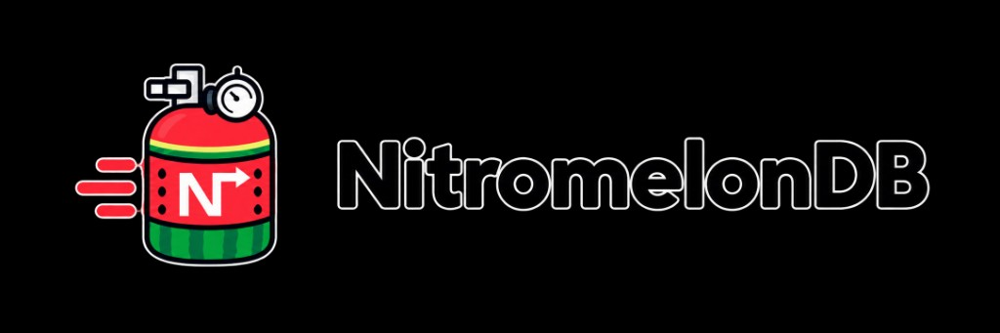

  

# About WatermelonDB

NitromelonDB continues [WatermelonDB](https://github.com/Nozbe/WatermelonDB), created by [Nozbe](https://github.com/Nozbe) and mainly written by [Radek Pietruszewski](https://github.com/radex). This page keeps the original introduction to the ideas behind it, lightly edited. For NitromelonDB itself, see the [README](https://github.com/StasDoskalenko/NitromelonDB#readme).

## Why Watermelon?

WatermelonDB is a different way to handle user data in React Native and React web apps.

It was built for **complex apps**, and its first goal is **real-world performance**. Put simply: your app has to launch fast.

For a simple app, Redux or MobX with a persistence adapter is the easiest way to go. But once you have thousands or tens of thousands of records, launch gets slow, especially on slower Android phones, because loading a whole database into JavaScript is expensive.

Watermelon fixes that **by being lazy**. Nothing is loaded until something asks for it. And because every query runs directly on [SQLite](https://www.sqlite.org/index.html), on a separate native thread, most queries return almost instantly.

Unlike using SQLite directly, Watermelon is **fully observable**. When you change a record, every part of the UI that depends on it re-renders on its own. Completing a task in a to-do app re-renders the task, the list (to reorder it), and every counter that includes it. [Learn more](https://www.youtube.com/watch?v=UlZ1QnFF4Cw) in the talk below.

|  |
| ---- |
| 
<a href="https://www.youtube.com/watch?v=UlZ1QnFF4Cw">📺 <strong>Next-generation React databases</strong> (a talk about WatermelonDB)</a>
 |

## The original pitch

|   | WatermelonDB |
| - | ------------ |
| ⚡️ | **Launch your app instantly**, no matter how much data you have |
| 📈 | **Highly scalable**, from hundreds to tens of thousands of records |
| 😎 | **Lazy loaded.** Data is loaded only when you need it |
| 🔄 | **Offline-first.** Sync with your own backend |
| ⚛️ | **Optimized for React.** Easily plug data into components |
| 🧰 | **Framework-agnostic.** Use the JS API with other UI frameworks |
| ✨ | **Reactive.** Optional [RxJS](https://github.com/ReactiveX/rxjs) API |
| 🔗 | **Relational.** Built on [SQLite](https://www.sqlite.org) |
| ✅ | **Proven.** Has powered [Nozbe](https://nozbe.com/teams) since 2017, and the apps below |

## Who uses WatermelonDB

These apps were built on WatermelonDB:

  

   

  

   

  

   

  

   

  

   

  

   

  

   

  

   

  

   

  

   

  

   

  

   

  

   

  

   

  

   

Does your app use NitromelonDB or WatermelonDB? Open a pull request and add your logo here.

## Credits

**WatermelonDB** was created by [@Nozbe](https://github.com/Nozbe). Its main author is [Radek Pietruszewski](https://github.com/radex) ([website](https://radex.io) ⋅ [𝕏 (Twitter)](https://twitter.com/radexp)). See the [original contributors](https://github.com/Nozbe/WatermelonDB/graphs/contributors).
