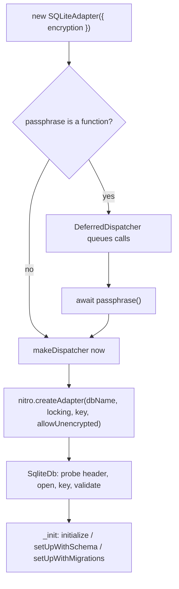

# SQLCipher-compatible database encryption

**Status:** In progress, not released yet (as of 2026-11-23). Steps 2-4 of the rollout (the opt-in encryption build, native keying, the JS API) are merged (#249, #250), with most of step 6's docs. The upgrade path (plain build → encryption build → encrypt in place) is tested on a device in CI on iOS, Android and Windows (#256-#259), and a reset keeps an encrypted database encrypted (`SqliteEncryptionTest`). Nothing blocks the first release (`0.33.0-alpha.0`); the remaining gaps are in [What's left](#whats-left). Step 5 (Node/Electron, with a real Jest suite) is implemented, and so are progress events (`onProgress`, a fraction) and the `useEncryption` hook. **Before the release, decide the file format** (see [Risks](#risks-and-things-to-verify), "SQLCipher tool compatibility"). Where the implementation differs from the design below, it says so in *Implemented:* notes. User docs: the [Encryption section](../../docs-website/docs/docs/Encryption/Intro.md).

This is the plan of record for #60. It supersedes `plans/database-encryption.md` (Zetetic SQLCipher with export-and-swap), whose safety requirements are folded in below under [Safety requirements](#safety-requirements).

**Related:** [#60](https://github.com/StasDoskalenko/NitromelonDB/issues/60) (Implement SQLCipher) · [#75](https://github.com/StasDoskalenko/NitromelonDB/pull/75) (SQLite 3.53.4 bump, prerequisite) · [Nozbe/WatermelonDB#1635](https://github.com/Nozbe/WatermelonDB/pull/1635) · [pinginc/watermelon-db#2](https://github.com/pinginc/watermelon-db/pull/2)

---

## Summary

Add opt-in, at-rest encryption to the SQLite adapter:

- A new `encryption` option on `SQLiteAdapter`, whose passphrase may be supplied **asynchronously** (keychain, biometric prompt, remote unlock) without forcing apps to restructure their database bootstrap.
- `database.unsafe_EncryptDB(passphrase)` and `database.unsafe_DecryptDB()` to migrate an existing database in either direction, **in place**, with writes blocked for the duration.
- `database.isDBEncrypted()` and a static pre-open probe so apps can tell which state they are in.
- Progress events, because rekeying a large database is not instant.

Databases are written in **SQLCipher v4 format**, so they remain readable by standard SQLCipher tooling.

## Why SQLite3MultipleCiphers instead of SQLCipher itself

Both linked PRs vendor Zetetic's SQLCipher amalgamation behind a build flag. That approach has four problems for this codebase:

1. **Crypto dependencies differ per platform.** SQLCipher needs an external provider: OpenSSL on Android (via the NDK prefab) and Windows, CommonCrypto on iOS. Three platforms, three configurations.
2. **The amalgamation is not distributable.** There is no downloadable SQLCipher amalgamation; it must be generated from source with `tclsh` and `./configure`. Both PRs solved this by committing a 250k-line generated blob, which cannot be refreshed by a script the way [`scripts/vendor-sqlite.mjs`](../../scripts/vendor-sqlite.mjs) refreshes SQLite today.
3. **SQLCipher cannot encrypt an existing plaintext database in place.** `PRAGMA rekey` only re-keys an already-encrypted database. Converting plaintext requires `ATTACH` + `sqlcipher_export` into a second file, then swapping and cleaning up — the temp-file dance we want to avoid.
4. **Neither PR actually migrates data.** The ping fork detects a plaintext database and *deletes it*, recreating it empty. That is a data-loss bug, not a migration.

[SQLite3MultipleCiphers](https://github.com/utelle/SQLite3MultipleCiphers) (sqlite3mc) avoids all four:

- Its `sqlcipher` cipher scheme is byte-compatible with SQLCipher v1–v4 database files.
- It bundles its own crypto. No OpenSSL, no CommonCrypto, identical build on every platform.
- It publishes an amalgamation zip per release, so `vendor-sqlite.mjs` keeps working essentially as-is.
- Its `PRAGMA rekey` handles **all three** directions — encrypt a plaintext DB, change the key, decrypt back to plaintext — in place, using a modified vacuum. No second file, no `.bak`.
- MIT licensed.

The engine swap uses **sqlite3mc 2.7.1, built on SQLite 3.54.1**, the exact SQLite version master vendored at the time. So the swap carries a **zero SQLite version delta**: it is purely `sqlite3.c` → `sqlite3mc_amalgamation.c`. That keeps the two concerns independently bisectable, which matters because SQLite upgrades can change SQL behavior and cipher swaps can change file format.

~~sqlite3mc also implements `sqlcipher_export()`~~ (it doesn't: that's SQLCipher's). For a copy, sqlite3mc has `VACUUM INTO 'file:...?key=...'`, which writes the copy with any key, or none. Decrypting uses it (see [Rekey](#rekey-off-the-js-thread)).

### Decision: encryption is a build-time opt-in

This plan first proposed compiling the codec into **every** build. That was reversed before shipping, for export compliance: Apple's encryption question covers an app "including any third-party libraries it links against", and an app that bundles standard encryption not provided by iOS falls in a different row of Apple's [documentation table](https://developer.apple.com/help/app-store-connect/reference/export-compliance-documentation-for-encryption) (a French encryption declaration if distributed in France). Compiling the cipher into everyone's app would change that answer for publishers who never asked for encryption, which breaks the "no silent behavior changes" rule.

So there are two builds, picked by the app:

| | Default | Encryption build |
| --- | --- | --- |
| Switch | none | `"nitromelondb": { "encryption": true }` in the app's `package.json`, or `NITROMELONDB_ENCRYPTION=1` |
| iOS | system `libsqlite3`, exactly as before | sqlite3mc from `native/vendor/sqlite3mc` |
| Android, Windows | `native/vendor/sqlite`, exactly as before | sqlite3mc from `native/vendor/sqlite3mc` |
| Crypto in the app | none from NitromelonDB | AES-256, HMAC-SHA512, PBKDF2 (standard) |

One switch for every platform, because it has to reach CocoaPods, Gradle and MSBuild and agree in all three, and `package.json` is the one file every React Native app has. The env var wins (CI). It is deliberately **not** an Expo config plugin option: the plugin throws if given `encryption`, pointing to `package.json`. Values must be booleans; anything else fails the build, so a typo can't silently produce the wrong build.

sqlite3mc cannot be compiled with zero ciphers (`#error "No suitable default codec type available"`), so "off" has to mean plain SQLite, not sqlite3mc with the cipher stripped. Both vendored copies are kept on the same SQLite version (checked by `yarn test:native-unit`, moved together by the weekly workflow), so turning encryption on never changes SQL behavior on Android and Windows.

The cost of opt-in is the upstream PR's failure mode: a flag that silently didn't apply. Hence the runtime guard in [Safety requirements](#safety-requirements): a passphrase given to a build without the codec must fail loudly.

## Public API

### Opening an encrypted database

```ts
const adapter = new SQLiteAdapter({
  schema,
  migrations,
  encryption: {
    // string, or a sync/async function resolved during adapter init
    passphrase: () => Keychain.getGenericPassword(),
  },
})
```

```ts
type Passphrase = string | (() => string | null) | (() => Promise<string | null>)

type EncryptionEvents = {
  onStart?: (info: {
    operation: 'encrypt' | 'decrypt' | 'rekey'
    pageCount: number
    byteSize: number
  }) => void
  onProgress?: (info: { elapsedMs: number; steps: number }) => void
  onSuccess?: () => void
  onError?: (error: Error) => void
}

type EncryptionOptions = {
  passphrase: Passphrase
  // What to do when a passphrase is set but the database on disk is plaintext.
  // 'error' (default) fails adapter setup.
  // 'open' opens it unencrypted so the app can migrate it via unsafe_EncryptDB().
  ifUnencrypted?: 'error' | 'open'
  events?: EncryptionEvents
}

// added to SQLiteAdapterOptions
encryption?: EncryptionOptions | undefined
```

Grouping these under `encryption` keeps `SQLiteAdapterOptions` readable and makes the three settings obviously related. `ifUnencrypted` is a policy, not a handler — the earlier `onPlaintextDatabase` name wrongly implied a callback.

*Implemented:* `onStart` also gets `operation` and `onSuccess` gets `{ operation, durationMs }`. `onProgress` gets `{ operation, progress }`, a fraction from 0 to 1 instead of a heartbeat (see the *Implemented* note under step 4's progress fidelity).

There is deliberately **no** `'encrypt'` auto-migrate mode. Rekeying can take many seconds; hiding it inside adapter construction makes it hard to show UI or handle failure. Migration is always an explicit call.

### Checking encryption state

Two different questions, two APIs.

**Is the connection I have open encrypted?** Read from state established during the open path:

```ts
adapter.isDBEncrypted(): Promise<boolean>    // awaits _initPromise first
database.isDBEncrypted(): Promise<boolean>   // passthrough, no writer needed
```

**Is the database on disk encrypted, before opening anything?** Static, since no adapter exists yet:

```ts
SQLiteAdapter.getDatabaseEncryptionState(dbName?: string):
  Promise<'encrypted' | 'unencrypted' | 'missing'>
```

Tri-state rather than boolean because `'missing'` (fresh install) is the case where you want to create an encrypted database rather than prompt for a key to something that does not exist.

> **Honest limitation.** The on-disk probe is definitive only in the negative direction. A plaintext SQLite file always begins with `"SQLite format 3\0"`, so `'unencrypted'` is reliable; `'encrypted'` really means "not a plaintext SQLite header", which a truncated or corrupt file also satisfies. Only a successful keyed open proves a file is genuinely encrypted, which is why `isDBEncrypted()` is the one to trust.

### Migrating an existing database

```ts
database.unsafe_EncryptDB(passphrase: string): Promise<void>
database.unsafe_DecryptDB(): Promise<void>
```

Both must be called from inside a writer. The complete upgrade flow for an app adding encryption to an existing plaintext install:

```js
const adapter = new SQLiteAdapter({
  schema,
  encryption: {
    passphrase: () => Keychain.getGenericPassword(),
    ifUnencrypted: 'open',
    events: {
      onStart: ({ byteSize }) => showSpinner(byteSize),
      onProgress: ({ elapsedMs }) => keepSpinnerAlive(elapsedMs),
      onSuccess: hideSpinner,
      onError: reportToSentry,
    },
  },
})
const database = new Database({ adapter, modelClasses })

// ...after boot
if (!(await database.isDBEncrypted())) {
  await database.write(async () => {
    await database.unsafe_EncryptDB(await Keychain.getGenericPassword())
  })
}
```

No data is ever deleted, and no temp file is created.

## Native design

### Vendoring

*Done.* `native/vendor/sqlite` (plain SQLite, default build) is unchanged. [`scripts/vendor-sqlite3mc.mjs`](../../scripts/vendor-sqlite3mc.mjs) vendors `native/vendor/sqlite3mc` from the GitHub release asset `sqlite3mc-<ver>-sqlite-<sqliteVer>-amalgamation.zip`, verifies it against the release's `SHA256SUMS`, and records both `sqlite3mc.version` and `sqlite.version`. [`.github/workflows/sqlite.yml`](../../.github/workflows/sqlite.yml) runs it with `--latest --if-newer`, then `vendor-sqlite.mjs` at the SQLite version that sqlite3mc release is built on, so both copies always move together.

`native/vendor/sqlite3mc/` keeps only `sqlite3mc_amalgamation.c` and `sqlite3mc_amalgamation.h`, plus `LICENSE` (MIT) and `COPYRIGHT`. The `.h` already contains `sqlite3.h`, so there is deliberately no `sqlite3.h` in that folder: in the encryption build a stray `#include <sqlite3.h>` fails to build (iOS, Android) instead of silently picking up another SQLite. Windows keeps `vendor\sqlite` on its include path in both builds, to leave the default build untouched.

### Symbol isolation

*Done, encryption build only.* [`native/shared/NitromelonSqlite.h`](../../native/shared/NitromelonSqlite.h) is the only way native code includes SQLite (in the default build it includes `<sqlite3.h>`, as before). Beyond the header shim this plan first proposed, the encryption build uses sqlite3mc's **dispatch-table mode** (`SQLITE3MC_USE_DISPATCH_TABLE`, prefix `nitromelon_sqlite3mc`): every SQLite function is compiled `static`, and only three prefixed table pointers are exported. Our `sqlite3_*` calls go through macros in the header.

This is what actually prevents the `redefinition of sqlite3_mem_methods` / duplicate-symbol failures reported against Nozbe#1635. A header shim alone stops us from *including* another SQLite, but not the linker from merging our symbols with expo-sqlite's, op-sqlite's or the SQLCipher pod's in a static build. The one rule of this mode: another SQLite copy in the same process must not open the same database file.

Two consequences:

- `sqlite3_temp_directory` is a global variable, which the tables cannot reach. `NitromelonSqlite.c` defines `nitromelon_sqlite3_set_temp_directory()` next to it; Android and Windows call that.
- sqlite3mc bundles parts of libsodium (ChaCha20, Poly1305) under libsodium's public names. `NitromelonSqlite.c` renames them with `#define`s. `yarn test:native-unit` runs `nm` on the object and fails on any export without the `nitromelon_` prefix, so a new one is caught by CI and by the weekly bump PR.

### Build wiring

*Done.* Every platform compiles [`native/shared/NitromelonSqlite.c`](../../native/shared/NitromelonSqlite.c), which includes [`NitromelonSqliteConfig.h`](../../native/shared/NitromelonSqliteConfig.h) and then the amalgamation that header selects: `vendor/sqlite3mc` with `NITROMELON_ENCRYPTION=1`, `vendor/sqlite` by default, or nothing on iOS by default (`NITROMELON_SYSTEM_SQLITE=1`, system `libsqlite3`). The build files only pass one of those two defines; every SQLite option lives in the header, so the C++ side and the C side cannot disagree. In the encryption build:

- `CODEC_TYPE=CODEC_TYPE_SQLCIPHER`, and every other cipher disabled (`AES_128_CBC`, `AES_256_CBC`, `CHACHA20`, `RC4`, `ASCON128`, `AEGIS`).
- `SQLITE_THREADSAFE=1`, `SQLITE_USE_URI=1` (iOS used to get URI support from Apple's build).
- `SQLITE_TEMP_STORE=1`, overriding sqlite3mc's default of 2, because Android deliberately spills temp data to an app-private directory. Keyed connections must set `pragma temp_store = memory` (step 3), since temp files are not encrypted.
- On Apple, parity with the system `libsqlite3` that the default iOS build links: `DEFAULT_WAL_SYNCHRONOUS=1` (otherwise every WAL commit would start to fsync), `DEFAULT_CKPTFULLFSYNC`, `DEFAULT_MEMSTATUS=0`, `MAX_VARIABLE_NUMBER=500000`, FTS3/4/5, R*Tree, math functions. `OMIT_LOAD_EXTENSION` is not copied: dispatch-table mode needs the extension API table. Extension loading stays off because we never call `sqlite3_enable_load_extension()`.

How each build system reads the switch:

- [`NitromelonDB.podspec`](../../NitromelonDB.podspec): env var, else the first `package.json` above `Pod::Config.instance.installation_root`, skipping NitromelonDB's own (CocoaPods evaluates podspecs from their own directory, so the lookup can start inside the library). Encryption: `-DNITROMELON_ENCRYPTION=1`, `native/vendor/sqlite3mc` on `HEADER_SEARCH_PATHS`, no `s.libraries`. Default: `-DNITROMELON_SYSTEM_SQLITE=1` and `s.libraries = 'sqlite3'`, as before. Read at `pod install`.
- [`native/android/build.gradle`](../../native/android/build.gradle): env var, else the first `package.json` above `rootProject.projectDir`, skipping ours; passes `-DNITROMELON_ENCRYPTION=ON|OFF` to [`android/CMakeLists.txt`](../../android/CMakeLists.txt), which picks the source dir and define.
- [`NitromelonDB.vcxproj`](../../native/windows/NitromelonDB/NitromelonDB.vcxproj): the `NitromelonDBEncryption` MSBuild property, else the env var, else a regex over the first `package.json` above `$(SolutionDir)` (MSBuild has no JSON parser, so the docs ask for a flat object). Not built locally from macOS; the CI `windows` job covers the default build only. No extra system libraries are needed: the RNG uses CommonCrypto on Apple (in libSystem), `getrandom` on Android, and `RtlGenRandom` on Windows (advapi32, linked by a pragma).

Measured size per arm64 slice at `-Os`, encryption build vs default: Android 0.85 MB → 0.96 MB; iOS +1.2 MB (the default links the system library), of which about 0.35 MB is the codec and the parity options.

### Open path

*Implemented* in [`native/shared/SqliteEncryption.cpp`](../../native/shared/SqliteEncryption.cpp) (`probeFile`, `openWithKey`, `rekey`), which needs only SQLite, so [`native/tests/SqliteEncryptionTest.cpp`](../../native/tests/SqliteEncryptionTest.cpp) tests it in both builds. Errors are `EncryptionError`s whose message starts with `[code]`; the JS dispatcher copies the code to `error.code`. An empty file counts as new (SQLite creates it empty). A build without the codec throws `encryption_unavailable` for any passphrase.

[`native/shared/Sqlite.cpp`](../../native/shared/Sqlite.cpp) — `SqliteDb(path, passphrase, allowUnencrypted)`:

1. Probe the first 16 bytes of the resolved path for `"SQLite format 3\0"`, skipping `:memory:` and `mode=memory` URIs. Absent or empty file means new; header match means plaintext; anything else means encrypted-or-corrupt.
2. `sqlite3_open_v2` exactly as today.
3. Key present, file not plaintext → `sqlite3_key_v2(sqlite, "main", key, len)`, then validate with `SELECT count(*) FROM sqlite_master;`. Failure throws `encryption_key_invalid`.
4. Key present, file is plaintext → throw `database_not_encrypted`, unless `allowUnencrypted`, in which case open unencrypted and record `encryptionState = Unencrypted`.
5. No key, file is encrypted → throw `encryption_key_required`, rather than letting the pragmas in the `Database` constructor fail opaquely.

Every failure is a distinguishable error code surfaced to JS. **The database file is never deleted.**

Also: apply the key with `sqlite3_key_v2`, never `PRAGMA key` (SQL text can end up in error messages and traces, and needs escaping); never log the key; set `pragma temp_store = memory` on keyed connections.

### Rekey, off the JS thread

Nitro `HybridObject` methods are synchronous, so a blocking rekey would freeze the JS thread and make progress events impossible to deliver. `changeEncryptionKey` therefore becomes an **async** Nitro method returning a `Promise`, executing on a background thread with progress marshalled back.

```cpp
void Database::changeEncryptionKey(const std::string &newKey, ProgressCallback onProgress) {
    const std::lock_guard<std::mutex> lock(mutex_);
    // reject if a transaction is open
    // finalize + clear cachedStatements_ (the pager is rewritten)
    // sqlite3_progress_handler(...) -> onProgress heartbeat
    // encrypting a plaintext DB requires leaving WAL first (sqlite3mc restriction)
    // sqlite3_rekey_v2(db_->sqlite, "main", newKey.empty() ? nullptr : newKey.data(), (int)newKey.size())
    // restore journal_mode, mirroring the _WIN32 memory-DB branch in the ctor
}
```

*Implemented* as `Database::changeEncryptionKey` + `encryption::rekey`, returned to JS by `Promise<void>::async`. Progress isn't a callback: `encryption::RekeyProgress` is updated on the re-key's thread, and JS polls `encryptionProgress()` (a synchronous Nitro method that doesn't take the database mutex) every 200 ms while the promise is pending.

*Crash safety, as found by `SqliteEncryptionTest`* (it crashes the re-key exactly at its commit through the unix VFS's `xSetSystemCall`, besides killing it at random times):

- **Encrypt and change key are in place.** Cut off at the commit, page 1 can already be in the new format while the journal still holds the old pages, so the header can't be trusted then. Rolling the journal back needs a connection set up like the one that wrote it (no key before an encrypt, the old key before a change); a connection with the wrong key fails to read and changes nothing. So `SqliteDb` calls `encryption::recoverInterruptedRekey()` before probing: with a hot journal, it tries the passphrase, then no key. After an interrupted key change, an app that already has only the new passphrase can't roll it back: the error says the change was interrupted and the old passphrase opens it.
- **Decrypt is by copy.** In place, a crash at the commit leaves a database **no key opens**: SQLCipher keeps the KDF salt in page 1, the commit rewrites page 1 as plaintext first, and the journal (encrypted) can no longer be decrypted with the salt that's left. So decrypting writes `VACUUM INTO '<path>-nitromelon-decrypted?key='`, syncs it, closes the connection, replaces the database file with it (`rename`, `MoveFileExW` on Windows) and reopens. Cut off before the rename, the database is untouched and the copy is deleted on the next open. That's why `SqliteDb` keeps the current passphrase while open: if the rename fails, it reopens the encrypted original. The new connection needs the connection's settings again (`Database::connectionSql_`); `rekey` reports the reopen, since the new connection can get the old one's address.

Deliberately do **not** touch `cachedRecords_` — rekey preserves every row, so the JS record cache stays coherent. This is the reason encrypt/decrypt does not require the disruptive teardown that `unsafeResetDatabase` does.

Moving rekey off-thread introduces a genuine concurrency window, which is precisely why write-blocking is required rather than merely defensive. Note that the native layer already provides a hard guarantee: **every** public `Database` method takes `mutex_`, so a concurrent query or batch blocks on the rekey rather than corrupting anything. The JS-side writer block is the graceful layer on top.

Progress fidelity is **indeterminate by design**. sqlite3mc's rekey is a single opaque call whose only hook is `sqlite3_progress_handler`, which fires every N VM steps and reports no page counts. We emit `onStart` with `pageCount`/`byteSize`, then a periodic `onProgress` heartbeat carrying `elapsedMs` and `steps`. That is enough to drive a spinner and prove liveness. A true percentage would require abandoning in-place rekey for a copy-based page-by-page export, reintroducing the temp file and roughly 2x disk usage.

*Implemented:* a real fraction, without giving up the in-place re-key. Each operation writes every page once to a file whose size can be read from another thread: decrypting writes the copy (`VACUUM INTO`); changing the key journals every page before rewriting it (rollback journal, since WAL is left first); encrypting is sqlite3mc's VACUUM into a temporary database (to make room for the HMAC), whose page count a `sqlite3_progress_handler` reads through `nitromelon_sqlite3_vacuum_page_count` (SQLite internals, next to the amalgamation in `NitromelonSqlite.c`), then a copy over the file that journals every page. `RekeyProgress::fraction()` turns these into 0..1 (encrypting: first half the temporary pages, second half the journal) and never moves back. `SqliteEncryptionTest` polls it from another thread in each direction and checks it's ordered, within 0..1, and passes through both halves. Node gets no progress: better-sqlite3 runs on the JS thread.

### Nitro spec

[`src/nitro/Nitromelon.nitro.ts`](../../src/nitro/Nitromelon.nitro.ts):

```ts
// Nitromelon (root)
createAdapter(
  dbName: string,
  usesExclusiveLocking: boolean,
  passphrase: string,          // '' = none
  allowUnencrypted: boolean,
): NitromelonDatabase
databaseEncryptionState(dbName: string): string   // 'encrypted' | 'unencrypted' | 'missing'

// NitromelonDatabase
getEncryptionState(): string                       // 'encrypted' | 'unencrypted'
changeEncryptionKey(
  newPassphrase: string,                           // '' = decrypt
  onProgress: (elapsedMs: number, steps: number) => void,
): Promise<void>
```

*Implemented differently:* `createAdapter` keeps its signature. The key goes in through `NitromelonDatabase.setEncryption(passphrase, allowUnencrypted)`, called before anything opens the connection (it opens lazily, on `initialize`); this keeps JS working against an older native build, which simply lacks the method. `setStoreWholeNumbersAsIntegers` no longer opens the connection either, so every opening error surfaces from `initialize`. The connection state is `isEncrypted(): boolean`; the root object also has `isEncryptionAvailable(): boolean`, and the file probe is `getDatabaseEncryptionState(dbName)`.

`databaseEncryptionState` lives on the root object because it must work with no open connection. It resolves the path via `platform::resolveDatabasePath` and reuses the same 16-byte probe as the open path, never opening sqlite — so it is cheap and cannot fail on a wrong key.

Regenerate the committed `nitrogen/generated/**` with `yarn specs`.

## JS design

### Async passphrase without breaking the synchronous constructor

The problem: `new SQLiteAdapter()` builds the native connection in its constructor, but a passphrase from a keychain arrives asynchronously.

*Implemented* as [`HoldingDispatcher`](../../src/adapters/sqlite/HoldingDispatcher.ts), used only with the `encryption` option. Calls made from the callback of a held call as it's sent go through first, as with a synchronous dispatcher (so `initialize` → `setUpWithSchema` isn't overtaken by app calls held behind `initialize`).

Add a `DeferredDispatcher` implementing `SqliteDispatcher` that buffers `call()` in FIFO order until the real dispatcher exists, then replays and passes through. In [`src/adapters/sqlite/index.ts`](../../src/adapters/sqlite/index.ts) the constructor keeps building the dispatcher **synchronously** when the passphrase is a string or absent — zero behavior change for existing users — and defers only when it is a function:

```ts
this._initPromise = Promise.resolve(resolvePassphrase(options.encryption?.passphrase))
  .then((key) => deferred._resolve(makeDispatcher(type, tag, dbName, { ...opts, passphrase: key ?? '' })))
  .then(() => toPromise((cb) => this._init(cb)))
```

Every adapter method already routes through `this._dispatcher.call`, and all consumers are callback-based via `ResultCallback`, so queueing is transparent. `getDispatcherType(options)` stays eager, so a missing `react-native-nitro-modules` still throws at construction rather than silently later. `testClone` must forward `encryption`.



### Blocking writes

Add optional `unsafe_ChangeEncryptionKey` and `getEncryptionState` to the `DatabaseAdapter` interface in [`src/adapters/type.ts`](../../src/adapters/type.ts), with promise wrappers in [`src/adapters/compat.ts`](../../src/adapters/compat.ts).

*Implemented differently:* the adapter interface methods are `isEncrypted` and `unsafeChangeEncryptionKey`. `Database` does not swap in `ErrorAdapter`: that would fail every query made meanwhile, and the app keeps running through an encryption (unlike a reset). Instead the `HoldingDispatcher` holds every adapter call until the re-key is done, then sends them in order; the writer slot still keeps other writers out. There's no cached encryption state in JS: `isDBEncrypted()` asks native.

In [`src/Database/index.ts`](../../src/Database/index.ts), modelled on `unsafeResetDatabase`:

- `this._ensureInWriter(...)` is what blocks writes. `WorkQueue._executeNext` runs exactly one reader or writer at a time, so holding the writer slot excludes everything else.
- Swap `this.adapter` for `ErrorAdapter` during the operation so stray direct adapter access fails loudly, then restore.
- Unlike reset, do **not** call `_abortPendingWork()` and do **not** clear collection caches. Queued work resumes afterward against identical data.
- Update the cached encryption state so `isDBEncrypted()` reads correctly immediately after.

## Node adapter

[`src/adapters/sqlite/sqlite-node/Database.ts`](../../src/adapters/sqlite/sqlite-node/Database.ts) hard-requires `better-sqlite3`. Change it to prefer `better-sqlite3-multiple-ciphers` (v13.0.3, drop-in, sqlite3mc inside) and fall back to `better-sqlite3`, erroring only if a passphrase is requested while the plain package is in use. Add the cipher package as a devDependency.

This is non-breaking for existing Node/Electron users and has an outsized payoff: it makes the entire feature testable under plain `yarn test` rather than only on device.

Thread the passphrase through `DatabaseDriver.init`, `DatabaseBridge.initialize`, and `nodeDispatcher`, applying `pragma cipher='sqlcipher'` then `pragma key=...` on open. The encryption-state probe is a plain `fs` read of the first 16 bytes.

*Implemented* in [`sqlite-node/encryption.ts`](../../src/adapters/sqlite/sqlite-node/encryption.ts), a port of `SqliteEncryption.cpp` (same error codes and messages, interrupted re-key recovery, leftover decrypt copy removed on open), with `better-sqlite3-multiple-ciphers` 13.2 (sqlite3mc 2.7.1, SQLite 3.54.1, as natively) as a devDependency. Differences from the design and from native:

- The key goes through better-sqlite3-multiple-ciphers' `key()` / `rekey()`, not `pragma key`, so it never is SQL text. Every connection sets `cipher = 'sqlcipher'` (the package defaults to ChaCha20) and `legacy = 4` (SQLCipher 4's layout, as natively; see Risks), keyed or not.
- **Decrypt by copy without URI filenames:** better-sqlite3 has none, so native's `VACUUM INTO 'file:...?key='` can't write a plain copy. Node writes `VACUUM INTO <copy>` (encrypted with the current key), decrypts the copy in place with `rekey('')`, syncs it, then renames it over the database. If that's cut off, only the copy is lost; the next open deletes it.
- **No WAL on Node**, so SQLite doesn't refuse a re-key while another connection is open. `DatabaseBridge.changeEncryptionKey` refuses (`rekey_failed`) when another connection in the same process has the same file open; other processes aren't detected (documented).
- **A file that isn't plain SQLite, opened without a passphrase**, is `encryption_key_required` (never touched) only with the cipher package installed. With plain `better-sqlite3` it stays a damaged database that `unsafeResetDatabase()` recreates, as on Node before: native's rule would have broken corruption recovery for every Node app. The Node tests of that recovery (`corruption`, `unsafeDestroyEverything`, `unsafeResetDatabase`) mock the cipher package away.
- `SQLiteAdapter` allows `encryption` on Node when `isEncryptionAvailable()`; without the package it throws `encryption_unavailable` naming it.
- **Tests:** `sqlite-node/__tests__/encryption.test.js` runs `SQLiteAdapter` + `Database` against real files (create, wrong/missing key leaving the file unchanged, `ifUnencrypted`, encrypt / re-key / decrypt with events, reset, the in-process connection check, in-memory, leftover copy, the plain-package fallback). Format parity both ways: Node opens `__tests__/fixtures/native-encrypted-k1.db` (written by the native build), and `SqliteEncryptionTest` opens `native/tests/fixtures/node-encrypted-k1.db` (written by Node).

## Safety requirements

Carried over from the superseded `plans/database-encryption.md`, which drew them from the four-year comment thread on Nozbe#1635. Each one is a test, not just a guideline.

- **No silent non-encryption.** The upstream PR's defining bug was a build flag that silently didn't apply, leaving a plaintext database. We have a build switch too (see the decision above), so this guard is mandatory: a passphrase given to a build without `NITROMELON_ENCRYPTION` throws a specific error naming the switch and the likely cause (switch in the wrong `package.json`, `pod install` not re-run, env var set to 0). The build logs announce the encryption build on every platform. A test reads the raw file header and asserts it is not `SQLite format 3\0` (already in `native/tests/SqliteEngineTest.cpp` for the engine).
- **No silent decryption.** A passphrase function that returns `null` (wiped keychain entry) is an error, never "open as plaintext". "No key" and "decrypt" are different inputs: decrypting is only ever `unsafe_DecryptDB()`.
- **No reset on a wrong key.** `_setUpWithMigrations` resets the database when it can't find a migration path. Keying errors (`encryption_key_invalid`, `encryption_key_required`, `database_not_encrypted`) must be routed away from that fallback, with a test.
- **Init failure rejects queued work.** If the passphrase can't be resolved, the `DeferredDispatcher` rejects every buffered call with the init error instead of hanging forever.
- **Crash during rekey.** Prove on device that killing the app mid-rekey leaves a database that opens with either the old or the new key. sqlite3mc rekeys inside a transaction, so the rollback journal should cover it. If it doesn't, use `sqlcipher_export` and swap the file instead. *Done on desktop:* `SqliteEncryptionTest` forks a child that encrypts, re-keys or decrypts a 10 MB WAL database, kills it with SIGKILL at points from the start of `sqlite3_rekey_v2` to past its end, and checks the database opens with the old or new key, with every row and `integrity_check` ok. Every kill passed. Not yet repeated on a device, and not on Windows at all (the test uses `fork` and the unix VFS; see W4 in [Windows handoff](#windows-handoff)).
- **`LokiJSAdapter` rejects `encryption`** with a clear "not supported on web" error rather than ignoring it.

## Testing

**Jest** (via the Node adapter): passphrase as string and as async function; deferred-dispatcher ordering, i.e. calls issued before the key resolves still execute in order; wrong key; encrypted DB opened with no key; plaintext DB with `ifUnencrypted: 'error'` vs `'open'`; encrypt → reopen with key; decrypt → reopen without key; data survives a full round trip; `isDBEncrypted()` and the static probe in every state; `unsafe_EncryptDB` outside a writer throws.

**Native integration** (`src/adapters/sqlite/integrationTest.js`): the same round trip on device, plus a smoke test of turbo sync (`unsafeLoadFromSync`) against an encrypted database. *So far:* the device suites run the default build, so they check that a passphrase fails with `encryption_unavailable` and that the file probe works. The encrypted round trip on a device is the CI jobs `NotesApp iOS (encryption upgrade)` and `NotesApp Android (encryption upgrade)` ([`scripts/ci-notesapp-encryption-upgrade.sh`](../../scripts/ci-notesapp-encryption-upgrade.sh), flows in `examples/NotesApp/maestro-encryption/`): the plain NotesApp build creates a database, the encryption build is installed over it, opens it with `ifUnencrypted: 'open'` and encrypts it; between steps the script checks the file in the app container (no SQLite header, a note's text not readable in any database file), and that the plain build installed over it fails with `encryption_key_required` and leaves the file byte for byte unchanged.

**Jest** today mocks the native dispatcher (`src/adapters/sqlite/__tests__/encryption.test.js`) until step 5 makes the Node adapter encrypt.

## Risks and things to verify

- ~~**SQLCipher tool compatibility (decide before the first release).**~~ *Resolved:* sqlite3mc's SQLCipher scheme defaults to its own layout (`legacy = 0`: page 1 encrypted from byte 24, bytes 16-23 plain), which SQLCipher can't open: SQLCipher's own `sqlcipher-4.0-testkey.db` fails with "file is not a database". Both engines now use SQLCipher 4's layout (`SQLITE3MC_USE_SQLCIPHER_LEGACY` natively, `pragma legacy = 4` on Node), and that file opens with its 78536 rows, as in SQLCipher's `sqlcipher-compatibility.test`; it's a fixture in `native/tests/fixtures/` (with Zetetic's license), read by the native and Node tests. sqlite3mc's docs advise against legacy mode for *new* databases within sqlite3mc; we take it anyway, because interoperability with SQLCipher (its tools, Room/SQLCipher, expo-sqlite `useSQLCipher`, op-sqlite `sqlcipher`) was this plan's premise from the start, and SQLCipher's format is what the ecosystem uses. Nothing was released in the other layout.

- **The Windows encryption build.** *Done:* it compiles (#256: C4996 and SDL checks off for the vendored `NitromelonSqlite.c` only), and the `Windows NotesApp (encryption upgrade)` CI job runs the same six upgrade steps as iOS and Android (#259). The `_WIN32` file code is exercised by that job and by decrypt checked by hand (#258); it has no native unit tests (W4 in [Windows handoff](#windows-handoff)).
- **Encrypting needs temp space.** sqlite3mc vacuums when the reserved bytes per page change (plain → SQLCipher). Encrypting starts from an unkeyed connection, so the vacuum's temp copy goes to the temp directory (plaintext, as the source was). Decrypting writes its copy next to the database instead.
- **iOS symbol collision** with a system `libsqlite3` pulled in by another pod (encryption build). Mitigated by dispatch-table mode (see [Symbol isolation](#symbol-isolation)) and enforced by the `nm` check in `yarn test:native-unit`. This is the exact failure reported against Nozbe#1635.
- **`unsafeResetDatabase`** uses `SQLITE_DBCONFIG_RESET_DATABASE` + `vacuum`. Confirm the key and per-page reserved bytes survive a reset, and re-key afterward if they do not. *Done:* they survive. `SqliteEncryptionTest`'s `resetKeepsEncryption` runs the same calls as `Database::unsafeResetDatabase` on a keyed connection, from WAL and from the rollback journal, and the file stays encrypted with the same key (no header, fails without the key and with a wrong one, `integrity_check` ok). No re-key needed.
- **Binary size** growth on Android and Windows, and the loss of system-SQLite sharing on iOS. Measure before and after; trim ciphers.
- **Disk space.** sqlite3mc vacuums when the per-page reserved byte count changes, so rekeying can transiently need up to 3x the database size.
- **WAL.** Encrypting a plaintext database requires leaving WAL mode first. Decrypt and plain re-key are fine in WAL as of sqlite3mc 2.4.0, at the cost of reusing the key salt.
- **Shared-database setups** (`SharingDatabaseAcrossTargets.md`, Headless JS) — every connection needs the key, and `usesExclusiveLocking` interacts with rekey.
- **Passphrase in memory.** We hold the key as a `std::string`/JS string. Document that this is not protected memory and that key custody is the app's responsibility.

## Suggested rollout order

1. ~~[#75](https://github.com/StasDoskalenko/NitromelonDB/pull/75) lands — SQLite 3.53.4.~~ *(done; master has since moved to 3.54.1, which sqlite3mc 2.7.1 matches)*
2. ~~Opt-in encryption build: vendor script, build switch, symbol isolation, build wiring for the three platforms, docs page. No API change; the default build is unchanged.~~ *(implemented)*
3. ~~Native encryption: open path, off-thread rekey, Nitro spec, regenerated bindings.~~ *(implemented; no progress callback yet)*
4. ~~JS surface: `encryption` option, deferred dispatcher, state checks, `unsafe_EncryptDB` / `unsafe_DecryptDB`.~~ *(implemented)*
5. ~~Node adapter and the jest suite.~~ *(implemented; see the Node adapter section)*
6. Docs: `Advanced/Encryption.md` exists (why opt-in, setup, verification, export compliance, the passphrase API, migration, key custody). Update `Setup.md` and `Implementation/DatabaseAdapters.md`; mark SQLCipher done in `README.md` and `Roadmap.md`.

## What's left

As of 2026-11-23. Nothing with encryption is on npm yet: the first release is planned as `0.33.0-alpha.0` (Prepare Release on master, `minor` + `alpha`). Gaps 1-2 were the blockers for it; both are done.

### Before the first release

1. ~~**Reset of an encrypted database (`unsafeResetDatabase`).**~~ *Done:* `resetKeepsEncryption` in [`SqliteEncryptionTest.cpp`](../../native/tests/SqliteEncryptionTest.cpp) shows the file stays encrypted with the same key after a reset, from WAL and from the rollback journal. No code change was needed. See [Risks](#risks-and-things-to-verify).
2. ~~**The Windows encryption build.**~~ *Done:* compiled (#256), setup-error screen on Windows (#257), the upgrade path in CI (#259), decrypt checked by hand (#258). W4 (native unit tests on Windows) is optional; see [Windows handoff](#windows-handoff).

### Soon after

3. ~~**Turbo sync against an encrypted database.**~~ The [Testing](#testing) plan asks for a smoke test of `unsafeLoadFromSync` on an encrypted database. *Done:* step 9 of the upgrade flow (iOS and Android) encrypts the decrypted database again, empties it ("Delete all"), and makes its first sync a Turbo Login (NotesApp's `turbo-sync-button`, against `examples/sync-server`), the login sync into an empty database that Turbo is documented for; after a cold start only the server's note is there, and the file has no SQLite header. Not on Windows, whose NotesApp has no sync tests. Also run by hand on an iOS simulator.
4. ~~**Decrypt on a device.**~~ `unsafe_DecryptDB()` is decrypt-by-copy (`VACUUM INTO`, sync, replace the file, reopen): the only path that replaces the database file. *Done:* NotesApp has a `decrypt-button` (encryption build, while encrypted; #258), checked by hand on Windows, including the failure when another process holds the file (`rekey_failed`, still encrypted with the same key). The upgrade flow has steps 7 (decrypt, add a note: plain header, marker readable) and 8 (the plain build opens it) on iOS, Android and Windows, and fails after any step if a `-nitromelon-decrypted` copy is in the data folder.
5. ~~**Apps with more than one connection.**~~ `Advanced/SharingDatabaseAcrossTargets.md` and Headless JS don't mention encryption. Every connection (app extension, widget, background task) needs the passphrase from a shared Keychain access group / storage; a connection opened while `unsafe_EncryptDB()` runs in another process will see a changed file. Document it, and say what `usesExclusiveLocking` does to it. *Done:* [More than one connection](../../docs-website/docs/docs/Encryption/MultipleConnections.md) (then in `Advanced/Encryption.md`, now its own page), linked from `SharingDatabaseAcrossTargets.md`. Encrypting, re-keying and decrypting leave WAL first, which SQLite refuses while another connection has the file open, so all three reject with `rekey_failed` and change nothing; `SqliteEncryptionTest`'s `rekeyRefusedWhileAnotherConnectionIsOpen` checks it for each, then that it works once the other connection closes.
6. **Kill during re-key on a device.** `SqliteEncryptionTest` proves it on desktop (POSIX). A device version: a Maestro step that kills the app while encrypting a large database (seed it first), then checks it opens with the old or the new key.
7. **Plan and docs housekeeping.** `Setup.md`, `Implementation/DatabaseAdapters.md` and `Roadmap.md` don't mention encryption. `Advanced/Encryption.md`'s "What we test" and "What's next" need updating as gaps close. Close #60 when the alpha is out and gaps 1-2 are done. *Done, except closing #60 (after the alpha):* `Setup.md` (a commented `encryption` option and a pointer), `DatabaseAdapters.md` (which platforms encrypt) and "What we test" / "What's next" are current. `Roadmap.md` is upstream's WatermelonDB roadmap and stays as it is: NitromelonDB's roadmap is in `README.md` and the docs home page, which already describe encryption's state; move it to done there with the release.

### Found by checking against the maintainers' docs (2026-11-23)

Every decision checked against the cipher maintainers' docs and what comparable libraries do:

| Decision | Industry practice / source | Result |
| --- | --- | --- |
| File format | SQLCipher 4 is the de facto format (Room/SQLCipher, expo-sqlite `useSQLCipher`, op-sqlite `sqlcipher`); sqlite3mc `legacy = 4` gives it ([sqlite3mc SQLCipher scheme](https://utelle.github.io/SQLite3MultipleCiphers/docs/ciphers/cipher_sqlcipher/)) | Changed from `legacy = 0`, see Risks |
| `secure_delete` on encrypted connections | SQLCipher turns it on by default since 2.0.5 ([Zetetic FAQ](https://discuss.zetetic.net/t/forensic-recovery-of-deleted-data/20)) | Added, natively and on Node |
| `temp_store = memory` | SQLCipher's build requires `SQLITE_TEMP_STORE=2` or `3` ([README](https://github.com/sqlcipher/sqlcipher#compiling)) | Already so (per connection) |
| Reset keeps encryption | Realm, Room/SQLCipher and SQLCipher's `VACUUM` all keep the configured key | Already so (#260) |
| Logout | Zetetic: delete the data with the old key, use a new one; NIST SP 800-88 cryptographic erase | Documented recipe |
| Encrypt existing data | SQLCipher: `sqlcipher_export` into a new file; sqlite3mc: `rekey` in place, rollback via the hot journal ([sqlite3mc rekey](https://utelle.github.io/SQLite3MultipleCiphers/docs/features/feat_rekey/)) | sqlite3mc's way, outside WAL as its docs require for rollback without the salt |
| Decrypt | SQLCipher: `sqlcipher_export` to a plain file; sqlite3mc: in-place rollback of a decrypt needs the old passphrase and salt | By copy, like `sqlcipher_export` |
| Build switch in the app's `package.json` | op-sqlite: `"op-sqlite": { "sqlcipher": true }`; expo-sqlite: a config plugin option | Same pattern as op-sqlite; unlike op-sqlite (which ignores a key without the flag), we fail loudly |
| Passphrase storage | Keychain / Keystore, `AFTER_FIRST_UNLOCK` for background work (OWASP MASTG: keys never next to the data) | Already so |
| iOS App Group containers | SQLCipher `cipher_plaintext_header_size` (32) + external salt; sqlite3mc FAQ | Not supported yet, documented (below) |
| Release lines' npm tags | No npm rule; `latest-1` / `release-1.x` are the community conventions | `latest-X.Y`, in line with them |


- **Plaintext header for iOS App Group containers.** iOS kills a suspended app holding a lock on a file in a shared container that it can't identify as SQLite; an encrypted database's header is random. SQLCipher's `cipher_plaintext_header_size` (recommended 32) and sqlite3mc's `plaintext_header_size` fix it, but then the KDF salt isn't in the file: the app has to keep it and pass it on every open (`cipher_salt`). Needs an API decision (who stores the salt: the app, or NitromelonDB in a sidecar file, since a salt isn't secret). Documented as a limitation in `Encryption/MultipleConnections.md` until then.
- **Logout recipe** (reset, then a new passphrase): documented, following Zetetic's advice and NIST's cryptographic erase. A one-call `unsafeResetDatabase({ newPassphrase })` only if apps ask for it.

### Then (rollout steps still open)

8. ~~**Step 5: Node/Electron**~~ through `better-sqlite3-multiple-ciphers` (see [Node adapter](#node-adapter)). Its bigger payoff is the jest suite: [`encryption.test.js`](../../src/adapters/sqlite/__tests__/encryption.test.js) mocks the native dispatcher today; with Node encrypting for real, the [Testing](#testing) cases (round trips, wrong key, reset, ordering, `ifUnencrypted`) run against a real encrypted file in `yarn test`, including on `ci-check-windows`. *Done:* see the *Implemented:* note in [Node adapter](#node-adapter).
9. **`onProgress` heartbeat** through `sqlite3_progress_handler` while the re-key runs off the JS thread (see [Rekey](#rekey-off-the-js-thread)). `onStart`/`onSuccess`/`onError` exist.
10. **Benchmarks** of a keyed database vs the default build (open cost from PBKDF2, read/write throughput), published on the docs page, which says today that we have none.

## Windows handoff

For whoever picks up gap 2 on a Windows machine. Goal: the Windows encryption build compiles, passes the same upgrade path as iOS and Android, and CI keeps it that way.

*Status (2026-11-23):* W1-W3 done (#256, #257, #258, #259); only the optional W4 is left. The steps below are kept as the record of what was checked.

**What exists for Windows (written on macOS, never compiled):**

- The switch in [`NitromelonDB.vcxproj`](../../native/windows/NitromelonDB/NitromelonDB.vcxproj) (lines ~24-35, 149-153, 224-226). In order: MSBuild property `NitromelonDBEncryption`, env `NITROMELONDB_ENCRYPTION`, then a regex over the first `package.json` above `$(SolutionDir)`; for NotesApp_windows that is `examples/NotesApp_windows/package.json`. The encryption branch defines `NITROMELON_ENCRYPTION=1` and prints `NitromelonDB: SQLite encryption build (SQLite3 Multiple Ciphers)`. `vendor\sqlite` stays on the include path in both builds; `NitromelonSqlite.c` picks the amalgamation.
- `_WIN32` code in [`SqliteEncryption.cpp`](../../native/shared/SqliteEncryption.cpp): `widePath` (UTF-8 → UTF-16 for every file call), `_wfopen_s` for the 16-byte header probe, `DeleteFileW`, `FlushFileBuffers` in `syncFile`, and `MoveFileExW(MOVEFILE_REPLACE_EXISTING | MOVEFILE_WRITE_THROUGH)` in `replaceFile`, which decrypt uses to swap in the decrypted copy.
- sqlite3mc's RNG uses `RtlGenRandom` (advapi32, linked by a `#pragma comment(lib)` inside the amalgamation). The temp directory is set with `nitromelon_sqlite3_set_temp_directory()`, as for the default build.
- NotesApp_windows renders `../NotesApp/src`, so the encryption build gets the same "Not encrypted" status, Encrypt button and setup-error screen as iOS/Android. Its database is `nitromelon-windows.db` in the app's `LocalState` (`%LOCALAPPDATA%\Packages\<PackageFamilyName>\LocalState`; `e2e/app-process.js` `localStateDir()` finds it).

**W1. Compile it.** In `examples/NotesApp_windows`, the same command as CI's `windows` job, with the switch:

```powershell
$env:NITROMELONDB_ENCRYPTION = '1'
yarn windows -- --arch x64 --release --logging --no-packager --no-launch
```

Check the log for the `SQLite encryption build` line, and that the built binary contains `SQLite3 Multiple Ciphers` while the default build's doesn't (`findstr /m /c:"SQLite3 Multiple Ciphers" <binary>`; it's the same check `ci-notesapp-encryption-upgrade.sh` does with `strings`). Likely trouble: MSVC warnings promoted to errors (`/sdl`, `/WX`) inside the sqlite3mc amalgamation (fix with per-file `DisableSpecificWarnings` on `NitromelonSqlite.c`, not by editing the vendored file); the libsodium renames in `NitromelonSqlite.c`; `NOMINMAX`/`WIN32_LEAN_AND_MEAN` clashes with RNW headers. Then build the default again and confirm it is unchanged.

**W2. The upgrade path by hand.** The same six steps as the [`maestro-encryption` table](../../examples/NotesApp/maestro-encryption/README.md), deploying the plain and encryption Release builds over each other (Debug and Release share one AppX identity, and so do the two builds):

1. Plain build: add a note "Upgrade marker". The file starts with `SQLite format 3` (`Format-Hex -Count 16`) and the marker is readable (`Select-String -Pattern 'Upgrade marker' -SimpleMatch` over the `.db` and `-wal`).
2. Encryption build over it. **First thing to verify: does redeploying keep `LocalState`?** The e2e `environment.js` wipes it on purpose; `run-windows` re-registers the package and should keep it, but nothing has checked. The note is there, status "Not encrypted", file unchanged.
3. Encrypt. No SQLite header, marker in no file (`.db`, `-wal`, `-journal`).
4. Restart the app: it opens with the passphrase, all notes there.
5. Plain build over it: the setup-error screen with `encryption_key_required`; `Get-FileHash` of the `.db` (+ `-wal`) is the same as before step 5.
6. Encryption build again: every note there.

Also, because decrypt is where Windows behaves differently (file replace while handles may be open): call `unsafe_DecryptDB()` (via a temporary button, or gap 4's) and check the file is plain again with every note, and that no `-nitromelon-decrypted` file is left in `LocalState`. If `MoveFileExW` fails (sharing violation from a handle still open on the database, e.g. a leftover `-wal`/`-shm` or an antivirus scan), the design says the connection reopens the encrypted original and `unsafe_DecryptDB()` rejects; check that's what happens rather than a crash.

**W3. CI.** Add the encryption build to the `windows` job (a second job or a matrix leg with `NITROMELONDB_ENCRYPTION: 1`), failing if the log lacks the build line, like `notesapp-android-build-encryption` does. Then the device test: a WinAppDriver version of the six steps under `examples/NotesApp_windows/e2e/` (keep `helpers.js` primitives; it must not use `environment.js`'s LocalState wipe between steps), with the on-disk checks in PowerShell or Node instead of `ci-notesapp-encryption-upgrade.sh`. It needs both builds in one job; watch the job's 90-minute timeout (two Release builds), and consider building both layouts before running anything. `yarn lint:workflows` can't run on Windows (action-validator has no Windows binary): run it on macOS/Linux, or rely on `workflow-lint.yml`.

**W4. Native unit tests on Windows (optional, after W1-W3).** `scripts/test-native-unit` is bash + `cc` + `nm`, and `SqliteEncryptionTest` uses `fork`, `SIGKILL` and the unix VFS's `xSetSystemCall`, so neither runs on Windows. Worth having for the Windows-only file code: guard the POSIX cases with `#ifndef _WIN32` and build the rest with MSVC (a small `.ps1` or CMake target). Windows-specific cases: a database path with non-ASCII characters (`widePath`), decrypt while another handle holds the database open (`MoveFileExW` fails → encrypted original reopened), a leftover `-nitromelon-decrypted` copy deleted on the next open. A kill-during-re-key on Windows would use `CreateProcess` + `TerminateProcess`; skip it unless W2 finds problems.

**Done when:** ~~the encryption build compiles in CI, the upgrade path passes on Windows in CI, decrypt has been checked on Windows, and `Advanced/Encryption.md`'s "Not yet on a device in CI: the Windows encryption build" line and What's next item 3 are removed.~~ All done.
